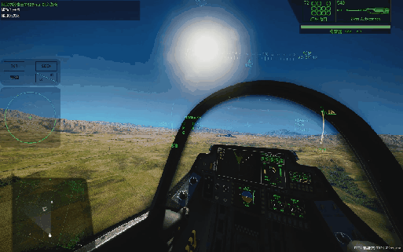

# Nuclear FX

Nuclear blast visual feedback for **Nuclear Option** — flash blindness, HUD blackout and restart, screen noise, and cockpit shake.

> Unofficial mod. Not affiliated with the Nuclear Option developers.



---

## Features

When a nuke detonates within effect range, the effect scales by yield and distance:

| Distance | Effect |
|---|---|
| Within `radius × 0.5` | Full blackout → fade-in → noise → HUD shutdown & restart → shake |
| `radius × 0.5` – `radius × 0.8` | Brief dim + noise + HUD shutdown & restart + shake |
| `radius × 0.8` – `radius` | Light shake + noise |
| **Looking at the blast** (inside `radius`) | **Blackout regardless of distance** |

Effect radius uses the game's own formula:

```
R (meters) = 13 × yield_kg^(1/3) × RadiusFactor
```

Yield is the `blastYield` argument of `Missile.Warhead.Detonate`, in **kg TNT**.

---

## Requirements

- **Nuclear Option** (Steam)
- **BepInEx 5.4.x (x64)** installed in the game root

---

## Installation

1. Download `NuclearFX-Package.zip` from [Releases](../../releases/latest)
2. Extract it
3. Drag the `plugins` folder into your game root:

```
.../steamapps/common/Nuclear Option/
├── NuclearOption.exe
├── winhttp.dll
└── BepInEx/
    └── plugins/
        └── NuclearFX/
            └── NuclearFX.dll
```

4. Launch the game. A successful load writes this line to `BepInEx/plugins/NuclearFX/nuclearfx.log`:

```
patched Warhead.Detonate
```

---

## Configuration

### In-game (recommended)

Press **F1** → **Nuclear FX**. Changes apply immediately.

### Config file

```
BepInEx/config/com.dsh.nuclearfx.cfg
```

A game restart is required after editing the file.

### Options

**[General]**

| Key | Default | Description |
|---|---|---|
| `NukeThresholdKg` | 1000 | Minimum yield (kg TNT) to count as a nuke |
| `RadiusFactor` | 1.0 | Effect radius = 13 × yield^(1/3) × factor |
| `DebugLog` | false | Log every nuke to `nuclearfx.log` |

**[Effect] Range**

| Key | Default | Description |
|---|---|---|
| `FlashRadiusFactor` | 0.5 | Blackout range = radius × this |
| `HudRadiusFactor` | 0.8 | HUD shutdown range = radius × this |
| `BlindAngleDegrees` | 35 | Line-of-sight angle for flash blindness |

**[Effect] Timing**

| Key | Default | Description |
|---|---|---|
| `BlackoutSeconds` | 0.5 | Full blackout duration |
| `BlindBlackoutMultiplier` | 1.8 | Blackout × this when flash-blinded |
| `FadeInSeconds` | 0.35 | Fade-in duration after blackout |
| `DarkenSeconds` | 0.28 | Dim duration outside blackout range |
| `HudDownSeconds` | 1.5 | Base HUD shutdown duration (scaled by strength) |
| `HudRestartFlickers` | 3 | HUD restart flicker count |
| `HudRestartOnMs` | 50 | Flicker-on duration (ms) |
| `HudRestartOffMs` | 90 | Flicker-off duration (ms) |

**[Effect] Visuals**

| Key | Default | Description |
|---|---|---|
| `NoiseStrength` | 0.6 | Max noise opacity (0–1) |
| `NoiseDuration` | 1.6 | Noise fade-out duration |
| `JitterStrength` | 22 | HUD shake amplitude (px) |
| `JitterSeconds` | 1.4 | HUD shake duration |

### Presets

**Hardcore**

```ini
BlackoutSeconds = 0.8
HudDownSeconds = 2.5
BlindAngleDegrees = 25
```

**Subtle**

```ini
FlashRadiusFactor = 0.35
NoiseStrength = 0.35
JitterStrength = 12
```

**Total blindness**

```ini
FlashRadiusFactor = 1.0
BlindAngleDegrees = 90
```

---

## Supported nukes

The plugin hooks `Missile.Warhead.Detonate`, so it covers anything using the stock detonation path:

| Nuke | Supported |
|---|---|
| Stock nukes (GPO-MK11 etc.) | ✅ |
| TsarBomba 5 / 10 / 15 / 20 / 25 / 50 MT | ✅ |
| Any mod using stock detonation | ✅ |
| Mods with fully custom explosion logic | ❌ |

Regular bombs fall below `NukeThresholdKg` and are ignored.

---

## Compatibility

- **NoNukeAftermath** — no conflict
- **TsarBomba** — no conflict
- **VWS (voice warning system)** — no conflict
- **Multiplayer** — client-side visuals only; different settings per player are fine

---

## Building from source

Needs the .NET Framework `csc` (ships with Windows) and the game's managed assemblies.

```powershell
csc /target:library /out:NuclearFX.dll ^
  /r:"<game>\BepInEx\core\BepInEx.dll" ^
  /r:"<game>\BepInEx\core\0Harmony.dll" ^
  /r:"<game>\NuclearOption_Data\Managed\Assembly-CSharp.dll" ^
  /r:"<game>\NuclearOption_Data\Managed\Mirage.dll" ^
  /r:"<game>\NuclearOption_Data\Managed\UnityEngine.dll" ^
  /r:"<game>\NuclearOption_Data\Managed\UnityEngine.CoreModule.dll" ^
  /r:"<game>\NuclearOption_Data\Managed\UnityEngine.UIModule.dll" ^
  /r:"<game>\NuclearOption_Data\Managed\UnityEngine.UI.dll" ^
  /r:"<game>\NuclearOption_Data\Managed\UnityEngine.AudioModule.dll" ^
  /r:"<game>\NuclearOption_Data\Managed\netstandard.dll" ^
  src\Plugin.cs
```

---

## Uninstalling

Delete `BepInEx/plugins/NuclearFX/`.

---

## Troubleshooting

Log file:

```
BepInEx/plugins/NuclearFX/nuclearfx.log
```

Expected output on a nearby nuke:

```
patched Warhead.Detonate
createOverlay ok, overlay=True
NUKE yield=250000000 dist=509 radius=8189 strength=0.94 angle=12 looking=True blind=True flash=True hud=True
effect start s=0.94 flash=True hud=True blind=True overlay=True
SetHud(False) FlightHud.i=ok
jitter start target=HUDCenter dur=1.4 strength=0.94
effect end
```

| Symptom | What to check |
|---|---|
| Nothing happens | Is `patched` in the log? Does the nuke use stock detonation? |
| `NUKE` logged but no `effect start` | Overlay creation failed — check the `createOverlay` lines |
| HUD doesn't hide | `FlightHud.i=ok` or `NULL` in the log (`NULL` = not in a vehicle) |
| No shake | Check `jitter start target=` to see which node was picked |
| Config options missing | Restart the game so new keys get written; or delete the cfg and relaunch |

---

## License

[MIT](LICENSE)
